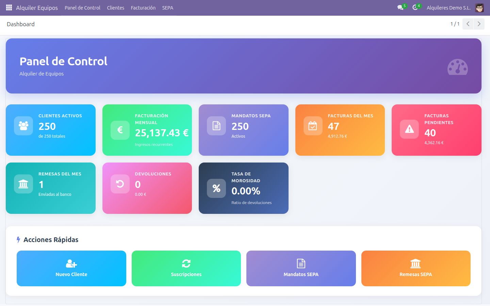
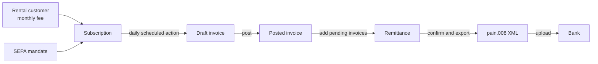
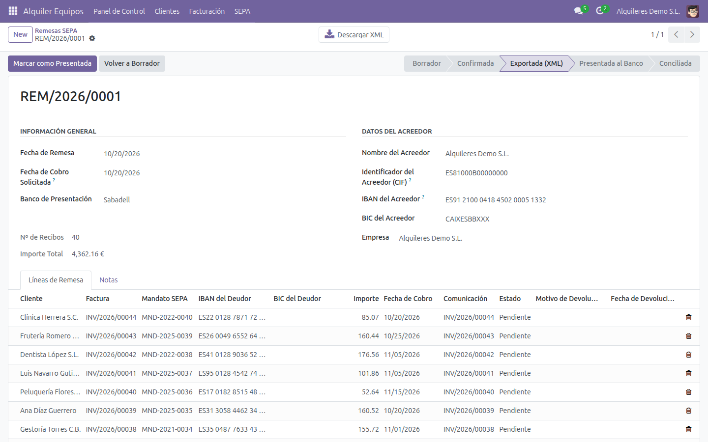
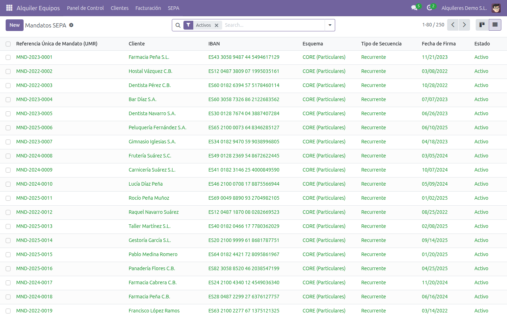
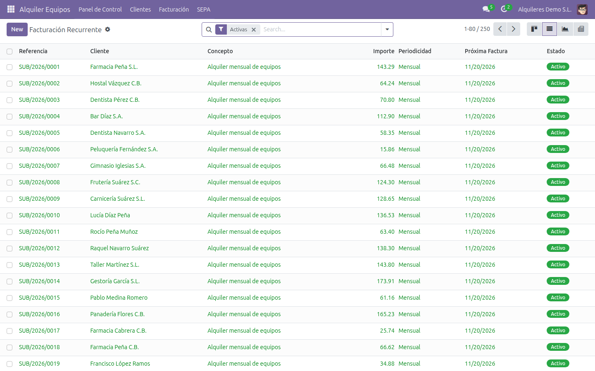
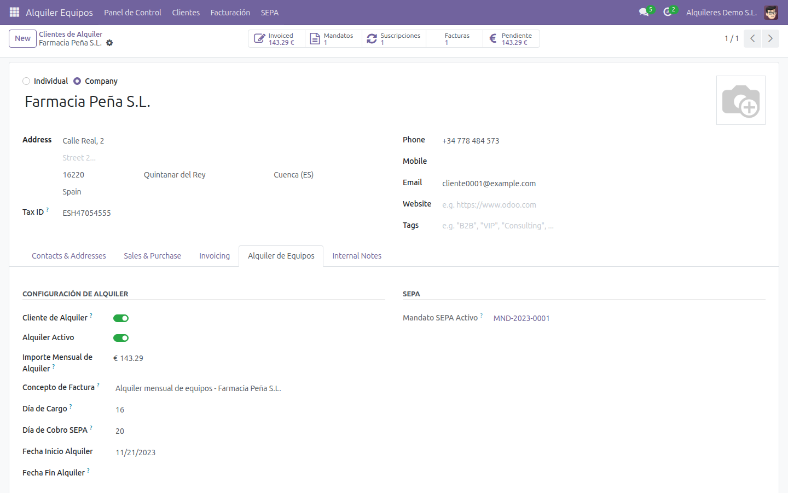

# Odoo Equipment Rental Billing with SEPA Direct Debit


An Odoo 17 module for businesses that rent out equipment for a monthly fee and collect it by SEPA Direct Debit.
It creates the recurring invoices, keeps track of each customer's SEPA mandate and produces the
ISO 20022 `pain.008` file you upload to your bank.



## Features

- **Recurring invoices**: monthly, quarterly or yearly subscriptions. A daily scheduled action creates the invoices, posts them if the subscription asks for it, and moves the next invoice date forward.
- **SEPA mandates**: unique mandate reference (UMR), debtor IBAN and BIC, CORE or B2B scheme, sequence type and signature date. Each mandate goes through draft, active, closed or revoked, and every change is tracked in the chatter.
- **SEPA remittances**: one click adds every posted, unpaid invoice whose customer has an active mandate. Each customer can have their own collection day.
- **`pain.008.001.02` export**: the XML file has one payment block per collection date, as SEPA requires when dates differ.
- **Remittance workflow**: Draft → Confirmed → Exported → Sent to bank → Reconciled → Closed. Returned debits are recorded per line with the reason and date.
- **Rental settings on the customer**: monthly fee, invoice description, invoice day, collection day and rental period. Smart buttons open the customer's mandates, subscriptions and invoices.
- **Dashboard**: active customers, monthly recurring revenue, active mandates, invoices this month, pending invoices, remittances, returns and return rate.
- **Access rights**: a *User* group and a *Manager* group.
- **Demo data**: 250 fictional customers with mandates and subscriptions, so you can try everything in a minute.

## How it works



## Screenshots

| SEPA remittance | SEPA mandates |
| --- | --- |
|  |  |
| **Recurring billing** | **Rental settings on the customer** |
|  |  |

## Installation

Requirements: Odoo 17.0 (Community or Enterprise). The module depends on `base`, `account`, `contacts` and `mail`.

The module's technical name is `alquiler_equipos`, so clone it into a folder with that name inside your addons path:

```bash
cd /path/to/your/addons
git clone https://github.com/Tony-aphrodite/OdooSystem.git alquiler_equipos
```

Restart Odoo, then go to **Apps → Update Apps List**, search for **Alquiler de Equipos** and click **Install**.
From the command line:

```bash
odoo-bin -d your_database -i alquiler_equipos
```

The interface is in Spanish.

## Configuration

1. **Settings → Users & Companies → Companies**: open your company and fill in **Identificador de Acreedor SEPA** (your SEPA creditor identifier).
2. On the company's contact, add the bank account that receives the payments (IBAN and bank with BIC).
   New remittances use the first bank account by default.
3. Install your country's accounting localization so the company currency is EUR (for Spain, `l10n_es`).

## Usage

1. **Customer**: *Alquiler Equipos → Clientes*. Open a customer, go to the **Alquiler de Equipos** tab and set the monthly fee, invoice day and collection day.
2. **Mandate**: *SEPA → Mandatos*. Create the mandate with its reference, bank account and signature date, then click **Activate**.
3. **Subscription**: *Facturación → Suscripciones*. Choose the customer, amount, interval, next invoice date and mandate, then click **Activate**.
   Tick **Publicar Automáticamente** to post each invoice as soon as it is created.
4. **Invoices**: the scheduled action *Alquiler: Generar Facturas Recurrentes* runs every day and creates draft invoices. Review and post them in Accounting.
5. **Remittance**: *SEPA → Remesas → New*. Set the requested collection date and click **Añadir Facturas Pendientes**, then **Confirmar** and **Generar XML SEPA**. Upload the file to your bank.
6. After the bank collects the payments, click **Marcar como Presentada**, then **Conciliar** and finally **Cerrar**.

### Sample output

A trimmed excerpt of a file generated from the demo data:

```xml
<Document xmlns="urn:iso:std:iso:20022:tech:xsd:pain.008.001.02">
  <CstmrDrctDbtInitn>
    <GrpHdr>
      <MsgId>SEPA-DD-REM-2026-0001-20261020150819</MsgId>
      <NbOfTxs>40</NbOfTxs>
      <CtrlSum>4362.16</CtrlSum>
      <InitgPty><Nm>Alquileres Demo S.L.</Nm></InitgPty>
    </GrpHdr>
    <PmtInf>
      <PmtMtd>DD</PmtMtd>
      <PmtTpInf>
        <SvcLvl><Cd>SEPA</Cd></SvcLvl>
        <LclInstrm><Cd>CORE</Cd></LclInstrm>
        <SeqTp>RCUR</SeqTp>
      </PmtTpInf>
      <ReqdColltnDt>2026-10-20</ReqdColltnDt>
      <!-- creditor, creditor account and creditor scheme id -->
      <DrctDbtTxInf>
        <PmtId><EndToEndId>INV/2026/00044</EndToEndId></PmtId>
        <InstdAmt Ccy="EUR">85.07</InstdAmt>
        <DrctDbtTx>
          <MndtRltdInf>
            <MndtId>MND-2022-0040</MndtId>
            <DtOfSgntr>2022-02-27</DtOfSgntr>
          </MndtRltdInf>
        </DrctDbtTx>
        <!-- debtor, debtor account and remittance information -->
      </DrctDbtTxInf>
    </PmtInf>
  </CstmrDrctDbtInitn>
</Document>
```

## Demo data

When the module is installed on a database **with demo data**, it adds:

- a fictional company, *Alquileres Demo S.L.*, with a sample creditor identifier and bank account;
- two users, `gestor` (manager) and `tecnico` (user);
- 250 fictional customers (references `DEMO-CLI-0001` to `DEMO-CLI-0250`) with fake IBANs, active mandates and monthly subscriptions.

On a database without demo data, none of this is created.
To remove the demo customers later, run this from an Odoo shell:

```python
from odoo.addons.alquiler_equipos.data.demo_cleanup import cleanup_demo_data
cleanup_demo_data(env)
```

## Data model

| Model | Purpose |
| --- | --- |
| `sepa.mandate` | SEPA Direct Debit mandate of a customer |
| `recurring.invoice` | Subscription that generates the periodic invoices |
| `sepa.remittance`, `sepa.remittance.line` | Batch of direct debits and the generated XML file |
| `alquiler.dashboard` | KPI dashboard |
| `res.partner` (extended) | Rental settings, mandates and subscriptions on the customer |
| `res.company` (extended) | SEPA creditor identifier |
| `account.move` (extended) | Link from each invoice to its subscription |

## Known limitations

- Every transaction is exported as `CORE` / `RCUR`. The scheme and sequence type stored on the mandate are not yet written to the file.
- The export uses `pain.008.001.02`. Check which version your bank accepts.
- **Conciliar** updates the remittance status only. Register the payments by reconciling the bank statement in Accounting.

Tested on Odoo 17.0 Community with Python 3.12 and PostgreSQL 16: installation with and without demo data, the recurring invoice job, remittance creation and XML export.

## Contributing

Issues and pull requests are welcome. If this module saves you time, a ⭐ helps other Odoo users find it.

## License

[LGPL-3.0](LICENSE)
